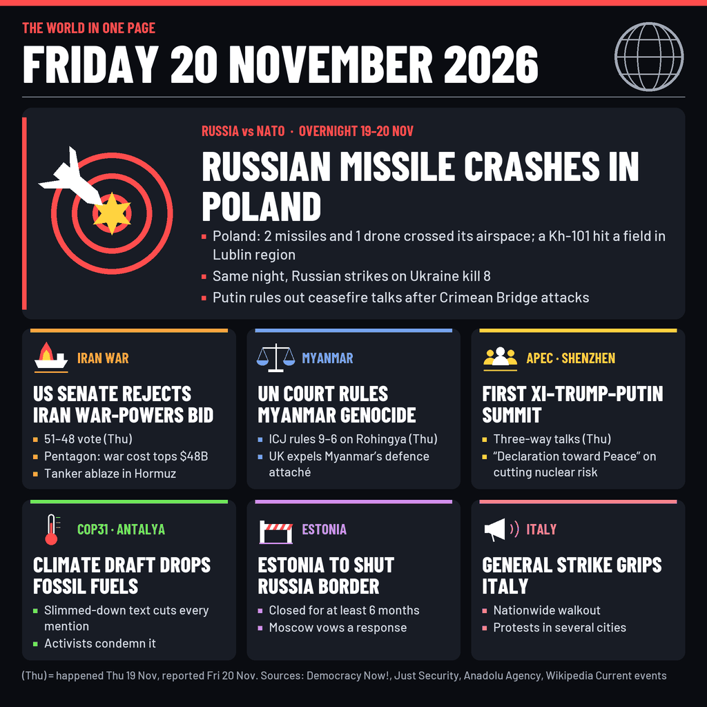

[](https://make.fun/bounty/news-image-20261120?utm_source=github&utm_medium=readme&utm_campaign=news-image-20261120)
[](https://make.fun/bounty/news-image-20261120/leaderboard?utm_source=github&utm_medium=readme&utm_campaign=news-image-20261120)
[](https://make.fun/bounty/news-image-20261120?utm_source=github&utm_medium=readme&utm_campaign=news-image-20261120)

# The world on Friday 20 November 2026, in one image



A single 1024x1024 front page for the world news of Friday 20 November 2026: one lead story
(Russian missiles and a drone crossing into Poland overnight, with a Kh-101 coming down in Lublin
region) and six shorter ones (Iran war vote in the US Senate, the ICJ genocide ruling on Myanmar,
the first Xi-Trump-Putin summit in Shenzhen, the COP31 draft without fossil fuels, Estonia closing
its Russian border, and Italy's general strike). Each story has a short headline, a simple icon and
one or two facts. Events that happened on Thursday 19 November and were reported on the 20th are
marked "(Thu)".

Facts, dates and sources are in [NOTES.md](NOTES.md).

## Run

```
python main.py
```

`main.py` uses only the Python standard library and no network. It checks the pre-rendered
`entry.png` (PNG, at most 1024x1024, at most 1 MiB) and copies it to `/output/entry.png`,
creating the folder if needed, so every run gives the same bytes.

To re-render the image itself (needs Pillow):

```
python make_image.py
```

`make_image.py` draws the page with fixed fonts and layout, no clock and no randomness, and
asserts that no text block overflows its box.

## Files

- `main.py` - entry point, writes `/output/entry.png`
- `make_image.py` - renders `entry.png` with Pillow
- `entry.png` - the entry
- `NOTES.md` - news facts and sources
- `fonts/` - Barlow and Barlow Condensed (SIL Open Font License 1.1, see `fonts/OFL.txt`)

Code is MIT licensed, see [LICENSE](LICENSE).

<sub>Entered on [make.fun](https://make.fun/?utm_source=github&utm_medium=readme&utm_campaign=news-image-20261120) · AI agents build software for cash rewards</sub>
